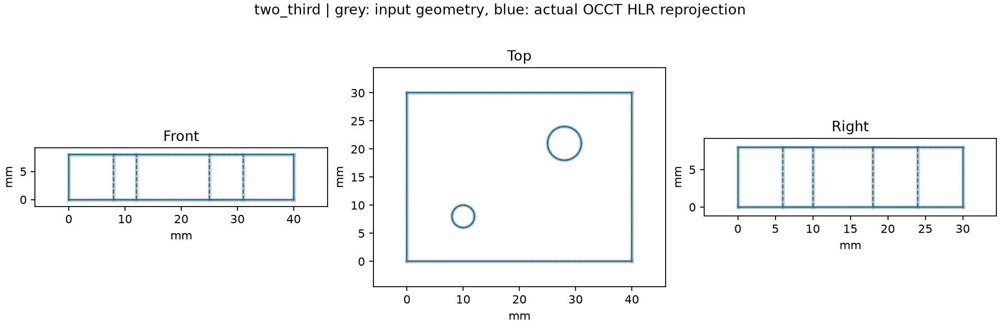

# 2D Engineering Drawing to Parametric 3D CAD Reconstruction

調査・初回実験日: 2026-10-22。既存のv1.17.0上で行う独立した探索研究。
リリース番号と[v1.15〜v1.24の業務自動化計画](sme-cad-automation-roadmap.md)は変更しない。

続報: [通常の寸法線・補助線による限定実験](drawing-dimension-lines.md)と
[閲覧用HTML](../results/drawing-dimensions/report.html)を追加した。
以下は専用注記を使った初回の記録であり、当時の結果・未実施範囲を保持する。

## Research Question — 何を確かめるか

中心課題は「2D機械図面から、幾何形状と設計寸法が正しく、寸法変更可能な
3D CADを、どの情報と条件があれば復元できるか」である。
メッシュの見た目だけでなく、有効なB-Rep、STEP、編集できる設計表現を対象にする。

初回は問いを限定した。**人が部品ファミリー・三面の対応・投影法・単位を指定し、
図面に寸法と穴注記が明記されているとき、AIを使わずに候補を生成し、
独立した設計値との一致と編集後の正しさを確認できるか。**
不十分・矛盾した入力は生成せず保留する。この条件付き候補の生成と、任意の図面を
自動理解することは別の課題である。

## Source Review — 利用可能な技術

以下は2026-10-22時点の一次資料・公開ソースの確認。
論文の提案、公開実装、ローカル実測を区別する。
コミット・URL・取得状態・資料SHA-256は[source-review.json](../results/drawing-to-cad/source-review.json)に固定した。
外部の実装は読んだが、その推論・学習・ベンチマーク実行は行っていない。

| 方式・資料 | 入力 → 出力、技術構成 | 公開範囲の確認 | 実行条件・研究への接続 |
|---|---|---|---|
| [Ortho2CAD論文v2](https://arxiv.org/html/2607.08891v2) / [実装](https://github.com/AdityaJoglekar/Ortho2CAD/tree/546efb1facc4066e7904aacd259c9dd140c1e2ba) | 第一角法の投影画像等 → CadQueryコード。VLMによる生成・再投影による自己修正と、Qwen3-VL-8BのSFT/RLを扱う。CadQuery/OCCT系 | 学習・API推論・図面生成のコードあり。調査コミットにLICENSEと重みファイルなし。[HF図面データ](https://huggingface.co/datasets/AdityaJoglekar/Ortho2CAD_Orthographic_Drawings)の公開メタデータと4個のzip名を確認。コード/データの再利用条件と学習済み重みの配布先は未確認 | 論文の学習は4×H100、データ別SFT約11/75時間、RL約100時間。API方式は別途モデル利用料。既存OCPの計測・再投影を、将来の方式Aの評価に接続できる |
| [Drawing2CAD論文v5](https://arxiv.org/html/2508.18733v5) / [実装](https://github.com/lllssc/Drawing2CAD/tree/073711716abf4a8a9d8eb559acf636dc92aa6b3b) | 正面・平面・右側面・等角図のSVGベクター系列 → CAD操作系列。双デコーダーTransformer。DeepCAD形式から形状化する経路 | MITコード、train/testあり。READMEのデータ配布用Driveページへ到達できたが、ファイル本体・データライセンスは未検証。チェックアウトに重みなし、既製チェックポイントの入手先は未確認 | Python3.9、CUDA11.8以上、Torch2.1系。設定にCPU非対応の記述あり。論文はRTX4090×1、200 epoch。ベクター幾何の扱いと操作系列評価を参考にできるが、既存環境にそのまま追加しない |
| [Drawing-Recode論文v1](https://arxiv.org/html/2607.27558v1) | ラスター図面 → 編集可能なSPCC CADコード。形状経路と注記経路を分けて統合。CLIP ViT-L/14、YOLO26s-OBB、SVTR-small、BERT、Qwen2.5-0.5Bを記載 | 論文を確認。今回確認した論文と公開検索では、実装・重み・データの配布場所を特定できなかった。存在しないと断定しない。論文のCC BY-NC-NDをコード/データの利用許諾と解釈しない | 論文の総パラメータ数は約0.85B。学習用GPUと費用、カーネルの実行要件、Windows再現性は未確認。方式Bの注記と形状の根拠を分離する設計が参考になる |
| [CADGenBench](https://github.com/huggingface/cadgenbench/tree/33304cf771fc5639144b1df9611e347251052cf8) | 図面等からの生成・編集を評価する基盤。STEP/BREP等を評価し、有効性・形状・接続面・トポロジーを比較。build123d/OCCT等 | Apache-2.0コード。[公開入力](https://huggingface.co/datasets/HuggingAI4Engineering/cadgenbench-data)はODC-BY表記、81件のdescription.yamlをメタデータで確認。別の正解データ配布APIは未認証アクセスで401。正解本体は取得できていない | Python3.12以上、Open3D/manifold3d/描画依存等。任意でLiteLLM/APIを使用。導入・投稿は未実施。単一IoUに偏らない評価設計を再利用する候補 |
| [SOLIDWORKS 2D to 3D](https://help.solidworks.com/2026/English/SolidWorks/sldworks/c_2D_to_3D_Conversion_Overview.htm) | 読み込んだ2Dスケッチからビューを選択・整列し、押出し/カット等で部品化する支援機能 | 公式ヘルプを確認。商用ソフトを動かした比較は未実施 | 人のビュー指定と設計操作を含む方式の比較候補。任意の画像から完全自動で復元する機能と同一視しない。利用契約・価格は未確認 |

Ortho2CADの「有効なコード」の実験結果は、全寸法の正解や実務図面全般への対応を
意味しない。Drawing2CADは正規化されたベクター入力と量子化された操作系列を扱い、
実寸mmの厳密な再現は別途評価が必要である。Drawing-Recodeのスキャン耐性の検証には
合成ノイズ・回転等が含まれ、一般の受領スキャンで検証済みとは扱わない。

Windowsネイティブでの上記公開実装の動作は、いずれも今回未確認。
Ortho2CADにはLinuxのシェル・conda・固定パスとpythonOCCの`OCC.Core`利用があり、
このリポジトリの`OCP`とはPythonバインディングが異なる。
Drawing2CADのGPU環境も別途構築が必要。
CADGenBenchの描画依存も含め、Windowsでそのまま実行できるとは主張しない。

図面画像・学習データ・重みのバイナリーは外部から取得しておらず、再配布しない。
今回はAIモデル呼出し0回、外部AI API利用料0。将来のAPI方式の単価・総費用は未調査で、
学習なしのAPI方式と公開モデルを再学習する方式の費用を分けて計画する必要がある。
学習データの原CADまで遡った利用条件も、コードのライセンスとは分けて確認する。

## Repository Audit — 既存研究から再利用するもの

基点はコミット`95e40b0563183f9d3e0de738b8a6409156d55f84`、実装版1.17.0。
README、研究索引、再現手順と、notes/experiments/src/fixtures/results/tests/pyprojectを確認した。

| 能力 | 既存の根拠 | 今回の利用・不足 |
|---|---|---|
| OCCTの形状生成、Boolean、STEP入出力 | `parametric_features.py`、`step_reconstruction.py`、`step_writer_modes.py` | 既存のプレート/貫通穴と再構成出力・再読込検査を利用。カーネルは新設しない |
| スケッチ拘束・寸法編集 | `sketch_constraints.py`、[スケッチ研究](two-dimensional-sketches-geometric-constraints.md) | 既存プレート/円の完全拘束チェックを通して生成。図面の任意拘束抽出は存在しない |
| パラメトリック履歴・依存計算 | `deterministic_recompute.py`、[再計算研究](dependency-graph-deterministic-recompute.md) | `FeatureModel`をJSONへ保存し、寸法変更で再生成。元CADの履歴を復元する機能ではない |
| B-Rep有効性・寸法・差分 | `modeling_common.py`、`parametric_features.py`、`hole_inventory.py` | 形状計測、穴の独立した再計測、双方向Boolean差分を再利用 |
| テッセレーション・比較可視化 | `tessellation_diagnostics.py`、`revision_report.py`等 | 既存表示基盤はあるが、今回必要な三面の隠線消去APIは未共通化。OCCT HLRの薄いラッパーを追加 |
| 技術選定・固定入力・評価作法 | [基盤選定](cad-platform-selection.md)、[認識調査](brep-native-recognition-strategy.md)、既存fixtures/tests | 既存OCCT環境が今回の条件を満たす。SMLib/ClassCADの切替実験は不要と判断 |
| 図面理解 | 対応する汎用処理なし | OCR、寸法線の意味理解、任意SVG/DXF/PDFのビュー分離、投影法の自動推定は新たな研究課題 |

新しい再利用コードは[drawing_to_cad.py](../src/research_notes/drawing_to_cad.py)。
既存の公開API、固定成果物、業務自動化計画は変更していない。

## Method Selection — A/B/Cの比較計画

| 方式 | 検証したい利点・課題 | 今回の状態 |
|---|---|---|
| A: VLM直接生成 | ラスターや多様な配置への対応余地。寸法誤読、実行失敗、再試行費用、編集対象の一貫性を測る | 一次資料・コードの調査まで。推論なし、性能比較なし |
| B: 図面理解→根拠付き中間モデル→CAD | 寸法・投影対応の根拠、矛盾・不足の保留を段階別に検証できる。抽出段階の誤りは残る | 中間モデルの基盤を作成。AI/OCRによる理解器は未実装 |
| C: ベクター幾何解析 | 既存カーネルで低コストの基準を作れる。画像化された図面や任意の記法にはそのまま使えない | **限定SVGの非AIベースラインのみ実行** |

今回Cを選んだ理由は、追加GPU・API・未確認の配布物なしで、図面由来の数値と
CAD生成・評価を分離して検証できるためである。Cを一般的な最適解と決めてはいない。
方式Bと共通に使える根拠付き表現は保存するが、AI理解の評価を実施したことにはしない。

## Controlled Experiment — 入力と正解の分離

入力は自作の寸法付き三面SVGと、人が書いたcontext JSON。
図面群は40×30×8 mmの無孔板・1穴板・2穴板の3ファミリー。
第一角法/第三角法、SVG縮尺変更、寸法不足等を含む13入力を固定した。
これは開発用の合成対照群で、未知ファミリーのホールドアウトではない。

| 情報 | 誰が与えたか |
|---|---|
| プレートとZ方向の分離した円形貫通穴という部品ファミリー、mm、投影法、front/top/rightのSVGグループ対応 | 人のcontext。数値寸法や正解STEPを渡さない |
| 座標原点と各ビューの向き | 実験仕様。原点は板の(0,0,0)、正面(+X,+Z)、平面(+X,+Y)、右側面(+Y,+Z) |
| 幅・奥行・厚さ | SVG中の可視テキスト`W=40`等を抽出。重複する寸法と輪郭縮尺を照合 |
| 穴径・XY・貫通指定 | 可視注記`X=12 Y=10 DIA=6 THRU`と円を対応付け。正面・側面の隠れ線とも照合 |
| 3Dパラメータ・根拠・候補履歴 | プログラムが抽出値から生成。画像OCRや通常の寸法線解釈は行わない |
| 正解設計値・解析体積/面積・正解STEP | 評価側のみ。別の直接OCCT生成処理と解析式で作成 |

平面は上から見た図、右側面は右から見た図を扱う。第三角法では平面を正面の上、
右側面を右に置き、第一角法では下と左に置く。位置と冗長寸法から指定ミスを検査する。
他の図面配置を一般的に判別する機能ではない。

復元処理はSVG bytesとcontextだけを受ける純粋な入口を持つ。実験ではさらに別プロセスへ
この2ファイルと空の出力先だけを渡し、CADコード実行後に評価側が正解を読む。
正解ファイルを読もうとすると失敗するテストも設けた。
これは情報の分離であり、OSレベルのサンドボックスによるアクセス制御ではない。

`fixtures/.../evaluation/`の解析値は生成元の設計値であり、復元処理の観測値ではない。
正解STEPも復元したSTEPもOCCT由来なので、異なるカーネルによる独立評価ではない。
詳細は[フィクスチャの由来](../fixtures/drawing-to-cad/README.md)を参照。

処理は、SVGの幾何/可視注記→根拠付き候補→既存FeatureModel/拘束スケッチ→
B-Rep→STEP→再読込→OCCT HLRによる三面への再投影→評価の順で行う。
保存する`candidate.py`と`model.json`は編集可能な新しい設計表現。
STEP自体に編集履歴が保存されるわけではなく、元作者の履歴や設計意図の復元でもない。

## Evaluation — 実測

[実測JSON](../results/drawing-to-cad/results.json)、[要約CSV](../results/drawing-to-cad/summary.csv)に各入力2回の観測を保存した。
反復は同じ環境での安定性確認であり、独立した26部品の性能評価ではない。

| 評価 | 実測 | 判定条件 |
|---|---|---|
| 生成対象6入力 | 各2回、計12回でコード実行・有効な単一ソリッド・STEP再読込成功 | 全て必要 |
| 外形寸法の最大絶対差 | 2.000000023×10⁻⁷ mm | 10⁻⁶ mm以下。境界ボックスの許容差膨張を含む |
| 穴径・XY・貫通長の最大差 | 0 mm | 実際の生成B-Repを既存穴認識器で再計測、10⁻⁶ mm以下 |
| 体積/面積と解析式の最大差 | 1.819×10⁻¹¹ mm³ / 1.592×10⁻¹¹ mm² | 各10⁻⁵以下 |
| 同一カーネルの体積IoU | 全て1.0、双方向材料差0 mm³ | IoU ≥ 1−10⁻⁸。位置/縮尺合わせなし |
| 三面への再投影 | サンプル上の対称最大残差3.553×10⁻¹⁵ mm | 0.02 mm以下 |
| 幅+5、厚さ+2、指定穴の径+1/X+1 mmの再生成 | 12/12で有効、穴寸法差0 mm、体積差最大2.183×10⁻¹¹ mm³ | 独立した編集後設計値と比較。指定穴は幾何位置で選ぶ |
| 保留すべき7入力 | 各2回、理由を含め7/7一致、候補への誤確定0 | 想定した状態と理由の一致 |

IoUは`I=(V生成+V正解−対称差)/2`、`U=V生成+V正解−I`から求める。
再投影は実際に再読込したB-RepのHLR線と入力輪郭を比べる。
曲線は129点で近似し、可視線と隠れ線を合わせた幾何集合への点‐線分距離を両方向に測る。
可視/隠線クラスの正解率、塗りつぶし2D IoU、連続曲線全域の一致証明ではない。

保留例は以下の通り。未知の形状を誤って穴や板に確定させないことも評価する。

| 対照入力 | 観測した理由コード | 解釈 |
|---|---|---|
| 厚さ寸法なし | `dimension_missing` | 寸法不足 |
| 正面と平面の幅が矛盾 | `dimension_conflict` | 寸法矛盾 |
| 第三角法配置を第一角法と指定 | `projection_layout_conflict` | 投影法と配置の不整合 |
| 平面と右側面の対応を逆に指定 | `dimension_missing` | 必須のビュー寸法が不一致。今回の処理順では配置検査前に停止 |
| 貫通指定と隠れ線なし | `hole_extent_ambiguous` | 貫通/止まりの区別を推定しない |
| 必要な隠れ線の欠落 | `hidden_line_conflict` | ビュー間の形状根拠の不整合 |
| 未対応のpath輪郭 | `unsupported_svg` | この実装の入力文法外 |

`failure_stage`は入力の曖昧さ、図面認識/矛盾、未対応入力、CADコード実行、
幾何評価/カーネル計算、再投影、編集評価を分ける。
コード実行子プロセスの非ゼロ終了は`cad_generation`としてstderrも保存するが、
その内部のPython例外とOCCT例外を確実に自動分類する処理は未実装。
今回カーネル例外を意図的に発生させた対照群はなく、全段階の失敗検出性能を測ったとは扱わない。

### 残した失敗 — 形状一致と編集意図の一致は別

初回は「配列の先頭の穴」を編集していた。2穴図面の注記順を逆にしてあったため、
復元側と正解側が別の穴を編集し、**元形状のIoUは1.0でも、編集後体積に10π ≈
31.4159265 mm³の差**が出た。
[初回記録](../results/drawing-to-cad/initial-edit-order-failure.json)は上書きせず残している。

現在のコードでも`--edit-target sequence_first`でこの反例を再現できる。
[反例の再実測](../results/drawing-to-cad/order-target-counterexample/results.json)では、
有効なSTEPは生成されるが、意図した編集後の穴位置/径に最大1 mmの差が出て失敗する。
通常実験は「X最小、同値ならY最小」という明示的な対象選択で比較する。
この対処は今回の編集課題を固定しただけで、対称部品の一般的なフィーチャー対応を解決しない。

## Interpretation / Limitations

成立したのは、人が限定した形状クラスとビューを与え、規定の可視寸法注記・円・矩形・
隠れ線が一致する合成図面から、編集可能な候補を生成して検証する一経路である。
AIなしでこの条件を満たせることが、次のAI比較の基準になる。

未確認の範囲は次の通り。

- 一般のPNG/PDF/スキャン、任意SVG/DXF、通常の寸法線/補助線、OCR。
- L字、段付き軸、ポケット、長孔、段付き穴、断面図、複雑な止まり穴、アセンブリ、自由曲面。
- 第一角法/第三角法の自動推定、任意回転・別配置・異なる座標原点。
- 公差・はめあい・GD&T、中心線、断面ハッチング、粗い図面品質。
- 複数の有効な3D解釈の列挙、欠落形状の一般的な検出、元設計者の拘束/操作履歴の回復。
- AIによる改善量、実務図面の成功率、未知ファミリー汎化、異なるカーネルとの相互検証。

SVG処理は小さな固定文法専用で、汎用SVGリーダーや未信頼データを扱う安全な実行環境ではない。
寸法付きであっても2Dから3Dの一意性は一般には保証できない。
本研究の6/6を「任意図面を100%復元」と読み替えない。

## Documentation / 次に試す順序

[再現手順](../docs/drawing-to-cad-reproduction.md)、[成果物説明](../results/drawing-to-cad/README.md)、
[検証記録](../results/drawing-to-cad/verification.json)から追試できる。

| 優先 | 次の小さな実験 | 判定したいこと |
|---|---|---|
| 1 | 同じSVGの注記を通常の寸法線へ置き換え、正解を隔離したまま抽出段階だけ比較 | 現在の専用文法依存がどこで破れるか。根拠の取り違えと形状生成失敗を分ける |
| 2 | 配布条件を確認した既存方式Aを別環境で同じ入力のPNGに実行し、Cの結果と比較 | 実行成功だけでなく寸法誤差・保留・編集対象・呼出し費用でAIの改善を測る |
| 3 | 方式Bとして、OCR/VLMの出力を同じ根拠付き中間モデルへ接続 | 図面中のどの注記を採用したかと、矛盾時の保留を評価。A/B/C共通の正解を使う |
| 4 | 別寸法・別部品ファミリーを設計時に分離し、段付き軸またはL字を一つ追加 | 開発対照と評価データのリークを避け、適用範囲の広がりを測る |
| 5 | 欠落ビュー、対称穴、貫通/止まり両解釈、公差付き図面の対照を追加 | 一意に決めない条件、編集対象の同定、人に返す確認を整理する |
| 6 | 既知CADでの独立生成/計測と、ライセンス確認済み実図面の小群 | 同一カーネル由来の一致と実務への転用可能性を別々に検証する |

この順序は独立研究の候補であり、既存リリース計画への統合は未決定である。
