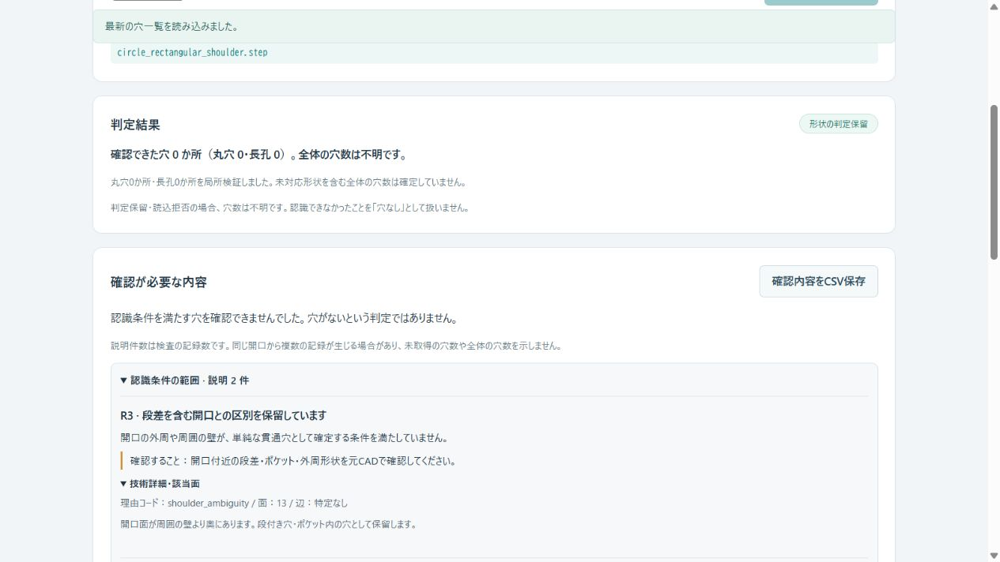

# Hole Review Explanations — v1.14.0

## 日本語概要

判定を保留した結果に、日本語の説明と「次に確認すること」を追加しました。
画面、Python API、CLI、確認用CSVで同じ説明を扱えます。
単に「判定できない」で終わらず、読込条件、精度、開口や内壁の条件などを確認できます。

説明は実際に失敗した検査の記録です。止まり穴・段付き穴・ねじ穴などを推測して
認識した結果ではありません。説明の追加によって認識範囲や許容差を広げていません。

既存の形状56入力と公開STEP6入力では、v1.13の穴の行、寸法、状態、全体数を維持しました。
公開ブラケットは丸穴5か所・長孔6か所を取得しますが、部品全体の穴数は未確定です。
板の確定結果2入力と読込拒否5入力を加え、69入力を各2回評価しました。

## English summary

Structured review items describe failed qualification checks, retain their raw
messages and available input-local face/edge references, and provide Japanese
next actions. Recognition predicates, tolerances and measured rows remain unchanged.
Unknown errors retain a generic explanation instead of guessing a feature type.
The UI and a separate review CSV distinguish certified zero from unconfirmed zero
and from an input that was never analysed.

## 利用者が確認できること

| 観測した条件 | 説明の例 | 次に確認すること |
| --- | --- | --- |
| 開口が周囲の壁より奥にある | 段差を含む開口との区別を保留 | 元CADで開口付近の段差・ポケット・外周を確認 |
| 必要な二つの開口が揃わない | 両端の開口を確認できない | 入口・出口・底・段差を確認。穴の種類は未確定 |
| 円筒が一周しない | 円筒の角度範囲を確認できない | 面分割・切欠き・円弧角度と出力精度を確認 |
| 開口が長孔の境界条件を満たさない | 半円二つと直線二つの条件を満たさない | 半円角度・径・直線・接続・分割を確認 |
| 半径などが小さすぎる | 寸法が判定許容差に近すぎる | 単位・寸法・検証の寸法下限を確認 |
| B-Repの許容差が上限を超える | 形状の許容差が認識条件を超える | STEP出力精度と面・辺・頂点を確認。加工公差判定とは別 |
| 構文検査で拒否 | 穴の解析は完了していない | 入力の破損や出力設定を確認して再出力 |
| 未知の処理エラー | 原因を自動分類できない／処理未完了 | 元メッセージと入力条件を記録して人が確認 |

画面の「確認が必要な内容」に理由と確認手順を表示します。
「技術詳細・該当面」を開くと理由コード、元メッセージ、参照可能な面・辺番号を表示します。
理由の面を自動選択する機能は追加していません。参照番号は読込後の入力内の番号で、
元CADの設計履歴や別ファイルの永続IDとの対応は保証しません。



## 0件と保留の区別

| 結果 | count_state | 全体の穴数 | 意味 |
| --- | --- | --- | --- |
| 板と穴の全体再構成が一致し、穴0件 | certified_zero | 0 | 対応範囲内で穴0件を確定 |
| 全体再構成が一致し、穴1件以上 | certified_count | 数値 | 対応範囲内の全体数を確定 |
| 局所確認11件のブラケット | unknown | 不明 | 確認済み11行。未取得形状や見逃しは未確定 |
| 認識条件を満たす行が0件 | unknown | 不明 | 穴なしとは判定していない |
| STEPの読込を拒否 | unknown | 不明 | 穴の有無は未判定。解析未完了 |

説明件数は穴数ではありません。同じ開口から丸穴・長孔側の検査や複数の面について
別々の記録が生じる場合があります。1件の説明を1個の未取得穴へ換算しません。
候補の検査以外に、全体数の未確定、単一辺の非円形内周の観測、設定、表示の説明も含みます。
単一辺の非円形内周は「対応する開口の境界を確認できない」と説明し、楕円穴などの種類は断定しません。

## 説明の分類と技術契約

| category | 表示 | 内容 |
| --- | --- | --- |
| input | 入力・読込条件 | 構文、単位、外部参照、読込上限、転送 |
| precision | 精度・許容差 | B-Rep許容差、小寸法、座標の桁精度 |
| scope | 認識条件の範囲 | ソリッド、円筒角度、開口、段差、長孔境界 |
| geometry | 形状証拠の不一致 | 所属、支持面、方向、接続、面積、材料の検証 |
| processing | 処理の失敗 | 幾何処理のエラーと未知の実行失敗 |
| coverage | 全体確認の保留 | 全体数未確定、確認行0件、丸穴のみの設定 |
| display | 表示の制限 | プレビューのみを省略 |

JSONには `review_schema_version="1.0.0"`、`review_summary`、`review_items` を追加しました。
各項目は `id`、`code`、`category`、`scope`、`severity`、`title`、`explanation`、
`next_action`、`face_indices`、`edge_indices`、`raw_reason` を持ちます。
`R1`などはその結果内の参照用です。列挙順や別の入力との同一性は保証しません。
`review`は人の確認が必要、`notice`は設定・表示の説明です。表示失敗だけで確認済みの穴数を撤回しません。

既知の検査境界では `ValueError` の派生型に理由コードを付けます。
認識条件・元メッセージ・既存の例外捕捉は維持します。
未知の値エラーは一般的な形状／入力の説明へ、未知の実行エラーは処理未完了へ返します。
メッセージ中の「blind」などの単語から穴の種類を推定しません。
最初に失敗した検査の説明であり、原因をすべて列挙する診断や自動修復ではありません。

## CSV・CLI・Python

`holes.csv`の28列と穴の行数は維持します。説明は別のUTF-8 BOM付き `review.csv` へ保存します。
CLIの出力は `inventory.json`、`holes.csv`、`review.csv`、`holes.svg` です。
画面の「確認内容をCSV保存」は `hole-review.csv` を保存します。
CSVの先頭はsummary行で、続くreview行が説明です。確定できない `hole_count` は空欄です。
ファイル名や元メッセージなどの数式先頭記号はエスケープします。

```bash
research-hole-list fixtures/public-step-corpus/sources/build123d_bracket.step --public --output-dir output/bracket-review
python -m research_notes.hole_review_benchmark --output-dir output/hole-review-check --repeats 2
```

ブラケットは部分確認のため終了コード2です。出力は保存されています。
completeは0、partial・unresolved・rejectedは2という既存契約を維持します。
空入力・2 MB超の要求エラーは前の状態を保持し、サイズ内の読込拒否は新入力の結果へ置換します。
確認用CSVにもトークン・リビジョンの照合を適用し、古い結果の取り違えを拒否します。

```python
from pathlib import Path
from research_notes.hole_inventory import analyze_step, review_csv

source = Path("fixtures/public-step-corpus/sources/build123d_bracket.step")
result = analyze_step(source.read_bytes(), source.name, inspection=True)
for item in result["review_items"]:
    print(item["title"], item["next_action"])
Path("bracket-review.csv").write_bytes(review_csv(result))
```

## 検証条件・再現記録

| 入力群 | 入力数 | 確認した穴の行数合計 | 説明記録数合計 |
| --- | ---: | ---: | ---: |
| 既存の頑健性評価STEP | 44 | 32 | 144 |
| 数値安定化の追加STEP | 12 | 8 | 51 |
| 公開STEP | 6 | 11 | 114 |
| 全体数を確定できる板 | 2 | 1 | 0 |
| 構文・単位・外部参照の拒否 | 5 | 0 | 5 |

各入力を同じ環境で2回評価し、説明を含む結果が一致しました。
前の62入力は、凍結したv1.13結果の穴の行・状態・全体数と一致します。
追加STEP12入力の16個の見逃しは残っています。説明の追加で認識できたことにはしていません。
既知の固定入力には分類不明のフォールバックがなく、未知エラーは別の注入テストで確認しました。
分類表の全コードを実部品で評価したという意味ではありません。

- [69入力の結果・コードと基準結果のSHA-256](../results/hole-review/results.json)
- [確認結果の一覧](../results/hole-review/matrix.csv)
- [段差付近の開口の確認用CSV](../results/hole-review/examples/circle_rectangular_shoulder.review.csv)
- [ブラケットの確認用CSV](../results/hole-review/examples/build123d_bracket.review.csv)
- [テスト・CLI・画面・パッケージの検証記録](../results/hole-review/verification.json)

WSL Ubuntu、Python 3.12、cadquery-ocp 7.9.3.1.1での固定入力の開発検証です。
一般の製造部品への精度保証、独立した寸法測定、部品全体の完全認識、
他部品による通路のふさがりの確認、ネイティブ処理の強制CPU・メモリ上限は追加していません。
